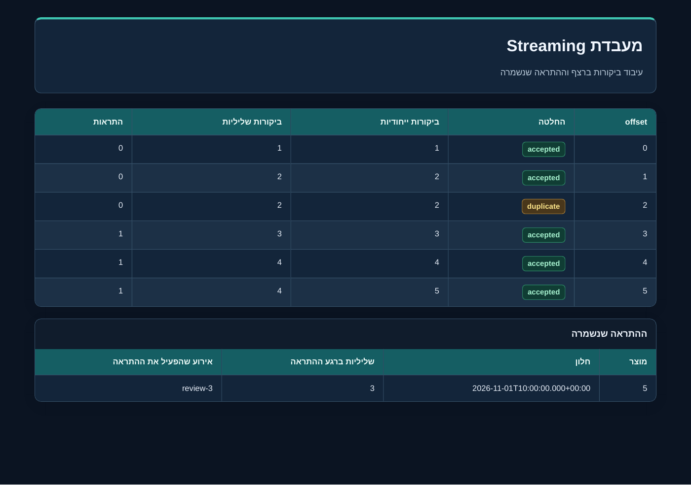

# Streaming Course Demo

<div dir="rtl">

יחידת לימוד מעשית לקליטה ולעיבוד של הזמנות שמגיעות ברצף. מיועדת לסטודנטים ולסביבת Windows עם Cursor, uv ו-Python 3.13.12. כל הנתונים סינתטיים.

המחברת **Streaming_Lab_HE.ipynb** מפעילה את הפרויקט ומציגה קלט, החלטות עיבוד, טבלאות הכנסות, אירועים מאוחרים, התראות ובדיקות. אפשר ללמוד עיבוד רשומה בכל פעם וגם עיבוד בקבוצות קטנות. הזרם ממשיך להגיע בשתי השיטות.

תצוגות התוצאות משתמשות ברקע כחול כהה, בכותרות טורקיז ובתגיות צבע להחלטות העיבוד. גם דוח ה-HTML משתמש באותו עיצוב. לאחר עדכון מהמאגר, הפעילו Restart Kernel ו-Run All כדי לרענן את התוצאות.



## התחלה ב-Windows וב-Cursor

להורדת הפרויקט מ-GitHub, פתחו PowerShell בתיקייה שבה תרצו לשמור אותו והריצו:

</div>

```powershell
git clone https://github.com/paulavrahami/streaming-course-demo.git
cd streaming-course-demo
```

<div dir="rtl">

פתחו את תיקיית הפרויקט ב-Cursor. פתחו Terminal מסוג PowerShell בתוך התיקייה שבה נמצאים pyproject.toml והמחברת. לאחר התקנת uv הריצו:

</div>

```powershell
uv python install 3.13.12
uv sync --locked
uv run python --version
```

<div dir="rtl">

הפקודה האחרונה צריכה להציג Python 3.13.12. פתחו את **Streaming_Lab_HE.ipynb**, לחצו על **Select Kernel** ובחרו את סביבת הפרויקט **.venv**. הנתיב ב-Windows הוא **.venv\Scripts\python.exe**. אם נדרשת תמיכה במחברות בעורך, התקינו את הרחבות Python ו-Jupyter הזמינות בו.

לחצו **Run All**, או הפעילו תא אחרי תא. כל ריצה יוצרת תיקייה חדשה תחת **lab_runs** ושומרת את התוצאות הקודמות. הצגת הבדיקות והטבלאות מתרחשת ישירות מתחת לתאים. בתא האחרון יש קישורים לדוח HTML ולטבלאות CSV.

אם הסביבה אינה מופיעה ברשימת ה-Kernels, רשמו אותה פעם אחת ואז בחרו אותה:

</div>

```powershell
uv run python -m ipykernel install --user --name streaming-course-demo --display-name "Python 3.13.12 (Streaming)"
```

<div dir="rtl">

הוראות מפורטות ופתרון תקלות: [מדריך Windows](docs/WINDOWS_HE.md).

## מה קורה בזמן ההרצה

יצרן יוצר הזמנות לאורך זמן. צרכן קורא מתור מוגבל ומעבד אותן, בזמן שהיצרן ממשיך לפעול. התצוגה מתעדכנת במהלך הניסוי. במסלול של קבוצות קטנות, העיבוד מתחיל כשהקבוצה מגיעה לגודל המרבי או כשמסתיים זמן ההמתנה שלה, לפי המוקדם.

הדוגמה המקומית נעצרת אחרי זמן קצר כדי לאפשר Run All בכיתה. לאחר עצירת היצרן, ההודעות שכבר נקלטו מתרוקנות מהתור. עצירת ההדגמה אינה מסיימת אוטומטית חלונות של זמן אירוע. בניסויי הקלט הסופי, finalize_demo מצהיר במפורש שהקלט נגמר.

## שני מסלולי הרצה

| מסלול | מה מפעילים | מה הוא מלמד |
|---|---|---|
| מקומי | Python, asyncio.Queue, SQLite | זרם חי, עיבוד בודד וקבוצות קטנות, חלונות, כפילויות, איחורים והתאוששות |
| ברוקר | Redpanda עם Kafka API ולקוח Python | לוג עמיד, יצרן וצרכן בתהליכים נפרדים, offset, קבוצות צרכנים ו-commit |

המסלול הראשי אינו דורש Docker, חשבון ענן או מפתח API. ההתקנה הראשונה דורשת אינטרנט להורדת Python והתלויות. לאחר מכן ההדגמה המקומית אינה פונה לרשת. מסלול הברוקר מתואר ב-[KAFKA_LAB.md](docs/KAFKA_LAB.md) ודורש Docker Desktop פועל ב-Windows, או ברוקר ניסוי קיים.

## פקודות קצרות

</div>

```powershell
# Deterministic fixture and persisted results
uv run python -m streaming_lab fixture --orders 300 --grace 10

# Real asynchronous local producer and consumer
uv run python -m streaming_lab live --seconds 4 --queue-size 8

# Crash and recovery comparison
uv run python -m streaming_lab recovery

# All automated tests, including the Kafka adapter contract
uv run --extra kafka python -m unittest discover -s tests -v

# Execute the entire notebook in a real Jupyter kernel
uv run python scripts/run_notebook.py
```

<div dir="rtl">

## איך רואים את התוצאות

| קובץ או תצוגה | מה רואים |
|---|---|
| תאים במחברת | הקלט, כללי העיבוד, החלטות ו-PASS של הבדיקות |
| lab_runs / תיקיית הריצה / report.html | דוח קריא בדפדפן |
| results.json | תוצאות ומדדים לקריאה בקוד |
| revenue_windows.csv | מספר הזמנות והכנסה באגורות לכל חלון |
| late_events.csv | הזמנות שהגיעו לאחר סגירת החלון |
| dead_letters.csv | קלט שלא עבר אימות והסיבה לכך |
| microbatch_comparison.csv | השוואת עיבוד בודד וקבוצות קטנות |
| קובצי SQLite בתיקיות המשנה | המצב והתוצאות שנשמרו באמת בדיסק |

הכנסות נשמרות באגורות כמספרים שלמים. לדוגמה, 12200 אגורות הן 122.00 שקלים. בזמן זרם חי, חלק מהסכום נמצא בחלונות פתוחים ולכן אין לסכם רק את טבלת החלונות הסגורים.

## תוצאות קבועות לבדיקה

בקלט הקטן יש 17 מסירות. מתקבלות 7 הזמנות בסך 122.00 שקלים, ושתי הזמנות מאוחרות בסך 13.00 שקלים נשמרות בנפרד. הסכום הכולל מתאים לחישוב המלא: 135.00 שקלים.

בקלט הגדול יש 300 הזמנות ייחודיות ו-17 מסירות כפולות. אותו קלט מורץ עם שלוש מדיניות קבלה:

| Grace בשניות | הזמנות שהתקבלו | הזמנות מאוחרות | הכנסה שהתקבלה בשקלים |
|---|---:|---:|---:|
| 0 | 279 | 21 | 56,916.90 |
| 10 | 286 | 14 | 57,954.30 |
| 120 | 300 | 0 | 61,241.70 |

המספרים האלה שייכים למחולל הקבוע, seed=7. מספר האירועים והזמנים בהדגמת הזרם החי תלויים במהירות המחשב.

## מבנה הפרויקט

| נתיב | תפקיד |
|---|---|
| Streaming_Lab_HE.ipynb | המחברת הראשית |
| src/streaming_lab | מנוע העיבוד, מחוללים, הדגמות ותצוגה |
| tests | בדיקות של עיבוד, התאוששות וחוזי הלקוח |
| docs/INSTRUCTOR_GUIDE_HE.md | מה להציג, מה לבדוק ואיך להסביר |
| docs/EXERCISE_HE.md | תרגיל ושאלות לסטודנטים |
| docs/ARCHITECTURE_HE.md | גבולות רכיבים והבטחות |
| docs/VALIDATION.md | מה נבדק בפועל ומה דורש סביבת ריצה נוספת |
| compose.yaml | ברוקר Redpanda וממשק Console למסלול הרשות |
| scripts/kafka_smoke.py | בדיקה אמיתית מול ברוקר, עם משאבים ייחודיים לריצה |

## גבולות ההדגמה

המסלול המקומי מדגים תור אסינכרוני בתוך תהליך יחיד. הוא אינו ברוקר עמיד. מנוע העיבוד שומר החלטה, מונים, חלונות, פלטים ו-checkpoint באותה עסקת SQLite. במסלול Kafka האישור לברוקר מתבצע בנפרד, אחרי השמירה המקומית. אין כאן הבטחת exactly-once לכל פעולה במערכת חיצונית.

קבוצה קטנה במחברת היא אופן תזמון של עיבוד. כל רשומה בתוכה נשמרת בעסקה משלה. חלון הכנסות הוא כלל צבירה נפרד לפי זמן האירוע. החיפוש בביקורות הוא חיפוש מילולי, ללא מודל embeddings.

מקורות: [Python asyncio](https://docs.python.org/3/library/asyncio-queue.html), [uv ו-Jupyter](https://docs.astral.sh/uv/guides/integration/jupyter/), [Kafka](https://kafka.apache.org/documentation/), [SQLite transactions](https://www.sqlite.org/lang_transaction.html).

</div>
