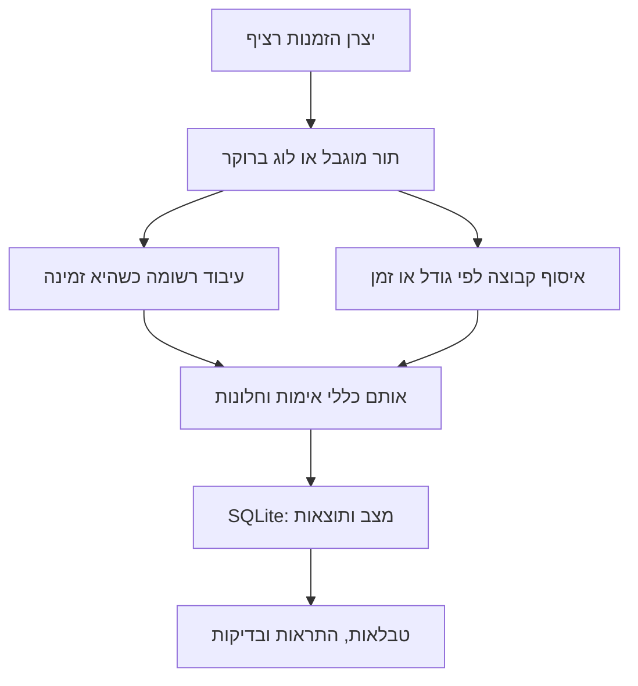

# ארכיטקטורת מעבדת Streaming

הזרם מורכב מהזמנות וביקורות חדשות. היצרן ממשיך ליצור אירועים בעוד שהצרכן מעבד אירועים שכבר נקלטו. במעבדה המקומית התקשורת נעשית בתור מוגבל בזיכרון; במסלול המתקדם התקשורת נעשית דרך לוג של Redpanda התואם ל-Kafka API.

## תפקידי הרכיבים

| רכיב | תפקיד | גבול האחריות |
|---|---|---|
| Producer | יצירת אירוע עם מזהה, זמן אירוע וסכום או דירוג | אינו מחשב את ההכנסה הסופית |
| ערוץ קליטה | הפרדת קצב ההגעה מקצב העיבוד | התור המקומי אינו שומר הודעות לאחר קריסת התהליך |
| צרכן רשומות | טיפול בכל הודעה כשהיא זמינה | אין המתנה יזומה לקבוצה |
| צרכן קבוצות | איסוף עד גודל או זמן מרבי והפעלת עיבוד | כל רשומה עדיין נשמרת בנפרד |
| StreamEngine | אימות, כפילויות, זמן אירוע, חלונות והתראות | מקור מסודר אחד לכל מסד |
| SQLite | מצב, פלטים, מונים ונקודת המשך בעסקה אחת | אינו כולל commit לברוקר או פעולה חיצונית |
| תצוגה ויצוא | הצגת תוצאות ושמירת CSV ו-JSON | אינה מקור האמת של העיבוד |

## שני אופני עיבוד של אותו זרם

שני הענפים מציגים אפשרויות עיבוד. בהשוואה במחברת כל אפשרות רצה בנפרד עם אותו קלט ומסד נפרד. אין לשלוח את שני הענפים לאותו מסד ולצפות להכנסה כפולה או לתחרות בעלות על offset.

## ציר הזמן אינו התור

קבוצה קטנה נקבעת לפי מספר רשומות וזמן איסוף בפועל. חלון ההכנסה נקבע לפי זמן האירוע. קבוצה אחת יכולה להכיל אירועים מכמה חלונות; חלון אחד יכול להתעדכן מכמה קבוצות. ה-watermark וה-grace קובעים מתי חלון מפסיק לקבל אירועים במסלול הראשי.

## שמירה והתאוששות

החלטת עיבוד, event_id, מונים, חלונות, פלטי צד ו-checkpoint נשמרים יחד ב-SQLite. קריסה לפני commit משאירה את המצב הקודם. קריסה אחרי commit משאירה את ההחלטה בשלמותה, והודעה שנקראת שוב מזוהה כ-replay.

במסלול הברוקר, אישור offset+1 מתבצע אחרי העסקה המקומית. חלון כשל בין הפעולות אפשרי ולכן נבדקת קריאה חוזרת. כל topic ומחיצה קשורים לזהות מסד; קבוצות צרכנים עצמאיות משתמשות במסדים נפרדים. ההדגמה תומכת במחיצה אחת לכל תהליך.

